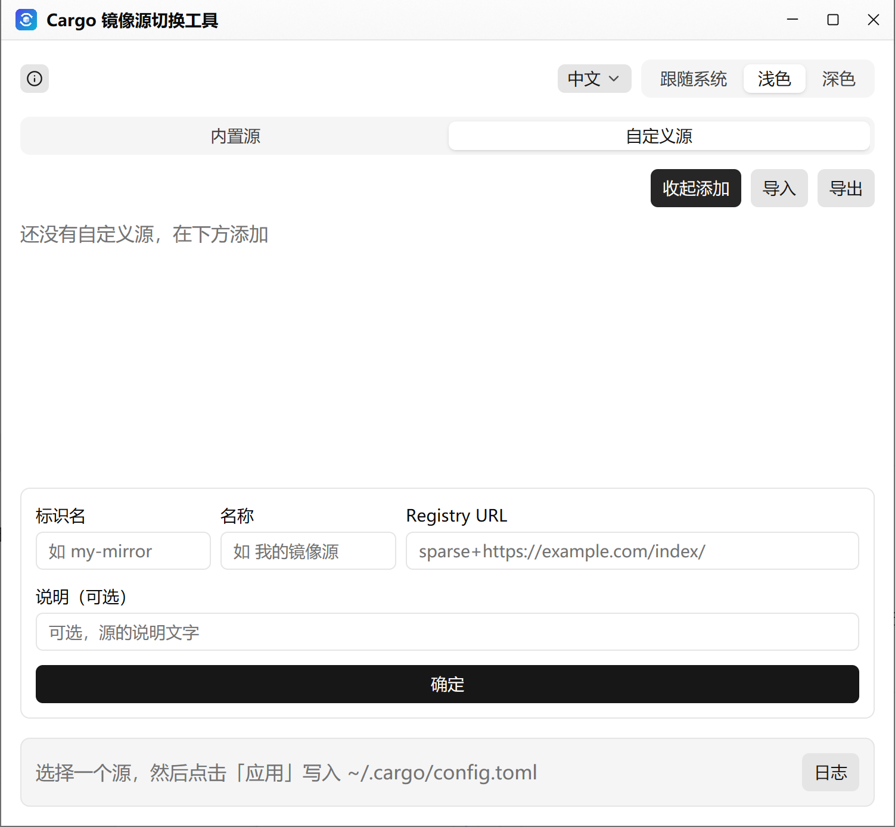
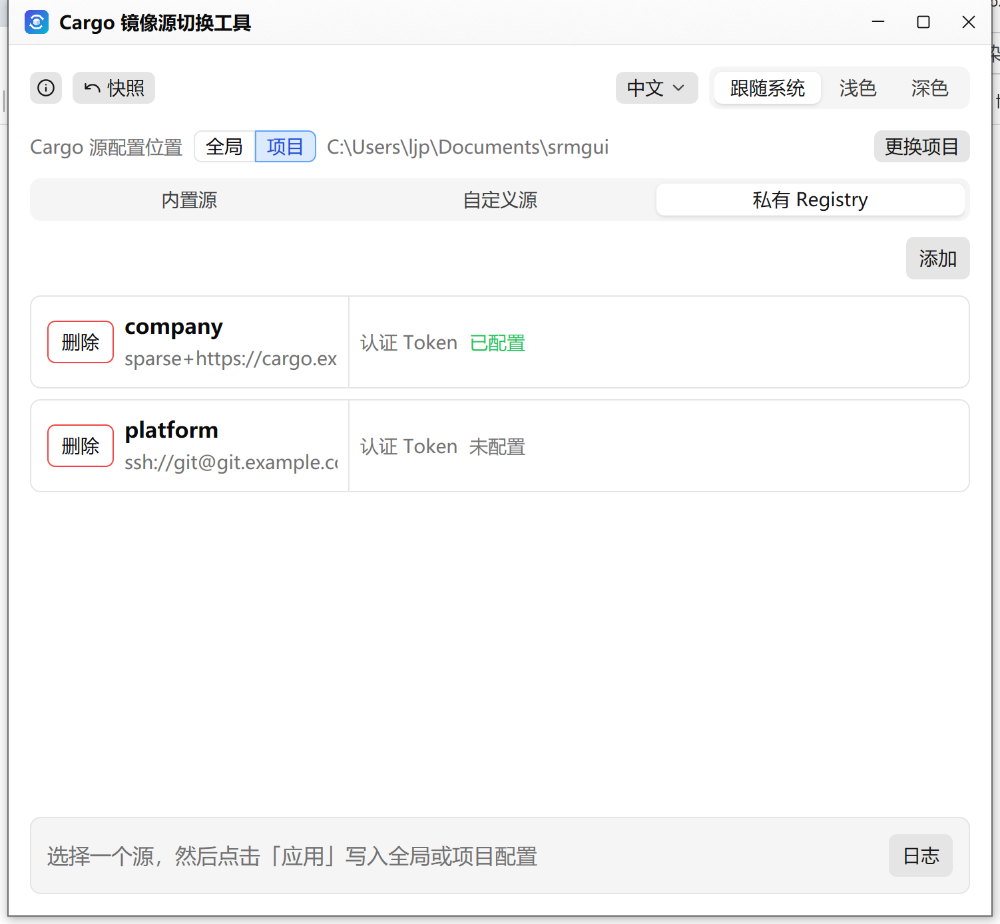

# srmgui

一个基于 [GPUI Kit](https://crates.io/crates/gpui-kit) 的桌面小工具，用于查看、测速并切换 Rust Cargo 的镜像源，同时支持企业私有 Registry 的索引与认证 token 管理，配置直接写入 Cargo 配置与凭据文件。

## 界面预览

| 内置源（测速结果） | 自定义源 |
| --- | --- |
|  |  |
| 私有 Registry | 添加私有 Registry |
|  |  |
| 日志面板 | 深色模式 |
|  |  |

## 功能特性

- **内置常用镜像源**：RsProxy、阿里云、中科大 USTC、清华 TUNA、上海交大 SJTUG、官方 crates.io，一键切换。
- **四层自动探测**：逐层检测并展示每个源是否真正可用：
  1. TCP 连接
  2. HTTP 索引探测
  3. 索引文件解析（按 sparse registry 协议校验 `config.json`）
  4. 下载测速（报告速度）
- **定时刷新**：启动后自动测速，并每 180 秒重新探测一轮。
- **自定义源**：支持添加任意 sparse registry，按标识名判重、自动补全 `sparse+https://` 前缀。
- **私有 Registry**：独立管理 `[registries.<name>]` 索引与认证 token，支持 sparse / git 索引，适配企业私有镜像；token 单独写入 `~/.cargo/credentials.toml`，不会进入项目配置。
- **导入 / 导出**：自定义源可导出为 srmgui 自定义的 `.srmgui` 文件，也可从该格式导入并自动合并（跳过内置源与重复标识）。
- **主题切换**：跟随系统 / 浅色 / 深色。
- **细节体验**：固定列宽布局，过长文字循环滚动显示，悬停显示完整详情 tips。
- **写入前预览**：点击「应用」先展示合并后的配置差异（行级 diff，`+` / `-` 着色），确认后才落盘，取消不产生任何改动。
- **配置快照与回滚**：每次写入前自动保留配置快照（最多最近 10 份），可一键恢复到任意一次；快照标签标注「切换前源」，与内容始终一致。
- **快照对比**：每条快照支持「与当前对比」，也可选定另一条快照互相对比，直观看出切换前后的配置变化。
- **自动检查更新**：启动后台检查 GitHub Releases 并每 6 小时复查，发现新版本时右上角提示；点击可选择用系统下载工具或应用内下载。
- **安全写入**：写入前自动备份原配置为 `config.toml.bak`。

## 内置源

| 标识名 | 名称 | Registry URL | 说明 |
| --- | --- | --- | --- |
| `rsproxy` | RsProxy（字节） | `sparse+https://rsproxy.cn/index/` | 国内实测最稳，推荐日常使用 |
| `aliyun` | 阿里云 | `sparse+https://mirrors.aliyun.com/crates.io-index/` | 备用源，偶发索引通但下载 404 |
| `ustc` | 中科大 USTC | `sparse+https://mirrors.ustc.edu.cn/crates.io-index/` | 文档仍在，连通性波动较大 |
| `tuna` | 清华 TUNA | `sparse+https://mirrors.tuna.tsinghua.edu.cn/crates.io-index/` | 帮助文档仍在，偶发无响应 |
| `sjtu` | 上海交大 SJTUG | `sparse+https://mirrors.sjtug.sjtu.edu.cn/crates.io-index/` | 高校源，适合应急 |
| `official` | 官方 crates.io | `sparse+https://index.crates.io/` | 默认源，`cargo publish` 前建议切回 |

## 使用

1. 启动程序，等待自动测速完成（每行依次显示 TCP / HTTP / 解析 / 下载四个步骤的结果）。
2. 点击目标源右侧的「应用」，在弹出的「写入前预览」中查看目标路径、变更摘要与 `+` / `-` 着色 diff，确认无误后点击「确认写入」，配置才会写入 `~/.cargo/config.toml`（优先使用 `$CARGO_HOME`）；点击「取消」不会产生任何改动。
3. 当前生效的源会在行尾显示「当前生效 ✅」。
4. 如需回退，点击标题栏的「快照」按钮，在列表中选择某次快照点击「恢复」即可。

### 写入前预览

「应用」不再直接落盘，而是先计算「现有配置 + 新源」的合并结果，并与当前文件做行级对比：

- 顶部显示本次写入的目标文件路径；
- 中间显示新增 / 删除行数与 diff 内容（`+` 为新增，`-` 为删除）；
- 只在点击「确认写入」后才写入，取消则完全不改动配置。

### 配置快照与回滚

每次真正写入前，srmgui 会把当时的配置内容保存为一份快照：

- 快照保存在 `<应用目录>/snapshots/`，最多保留最近 10 份，超出后自动删除最旧的；
- 快照记录的是**切换前**的配置，列表标签以「切换前源」标注当时实际生效的源；
- 点击「快照」→ 某条记录的「恢复」即可回滚，恢复前仍会把当前文件备份为 `.bak`；
- 每条快照还提供「与当前对比」和「对比」（选择另一份快照）两个入口，用只读 diff 查看差异。

### 自定义源

在「自定义源」标签页填写标识名、名称、Registry URL（说明可选）后点击「添加」。URL 若未带协议，会自动规范化为 `sparse+https://<host>/`。

### 私有 Registry

在「私有 Registry」标签页管理企业私有镜像，和内置源替换是两套独立配置：

- **名称**：对应 `Cargo.toml` 中 `registry = "名称"` 的标识，仅允许字母、数字、连字符与下划线，`crates-io` 为保留名称；
- **Index URL**：支持 `sparse+https://...` sparse 索引，也支持 `https://...`、`ssh://...`、`git@...` 等 git 索引；未带协议时自动补全为 `sparse+https://<host>/`；
- **认证 Token（可选）**：写入 `$CARGO_HOME/credentials.toml` 的 `[registries.<name>]`，列表中显示「已配置 / 未配置」。匿名只读镜像或使用 credential provider 时可留空；
- 索引写入当前作用域的 `config.toml`（全局或项目级），删除时会同步移除对应 registry，并在没有其他配置引用时清理 token。

### 导入 / 导出

- **导出**：将当前所有非内置的自定义源保存为 `.srmgui` 文件（未写扩展名时自动补全），包含标识名、名称、URL、说明。
- **导入**：选择 `.srmgui` 文件，按以下规则合并：
  - 跳过与内置源同名的标识；
  - 跳过已存在的标识；
  - 新增项立即参与测速。

`.srmgui` 是 srmgui 自定义的 TOML 格式（v2）：

```toml
# srmgui 自定义源文件，可通过 srmgui 导入
format = "srmgui.sources"
version = 2

[[source]]
id = "demo-src"
name = "演示源"
url = "sparse+https://demo.example.com/index/"
description = "这是一个演示源"
```

导入时会校验 `format` 与 `version`，`id` / `url` 缺一不可；`name` 缺省时回退为 `id`，`description` 缺省为空。兼容 v1 格式（`name` 作为标识名）。

### 检查更新

应用启动后会在后台检查 GitHub Releases，之后每 6 小时复查一次：

- 发现新版本且存在当前平台的安装包时，窗口右上角显示「发现新版本 x.y.z」；
- 点击后可选择下载方式：
  - **系统下载工具**：用系统默认浏览器 / 下载器打开安装包链接；
  - **应用内下载**：在应用内下载对应平台的安装包，完成后自动启动安装；
- 检查结果、下载与安装过程都会写入日志面板。

## 写入的配置

应用某个源后，`~/.cargo/config.toml` 的内容形如：

```toml
[source.crates-io]
replace-with = "rsproxy"

[source.rsproxy]
registry = "sparse+https://rsproxy.cn/index/"

# ...其余内置源与自定义源...

[net]
git-fetch-with-cli = true
```

选择「官方 crates.io」时不写 `replace-with`，即回到 Cargo 默认行为。

私有 Registry 的索引与 token 分开存放：

```toml
# ~/.cargo/config.toml
[registries.company]
index = "sparse+https://cargo.example.com/index/"
```

```toml
# ~/.cargo/credentials.toml
[registries.company]
token = "******"
```

## 构建与运行

需要 Rust 工具链（edition 2024）。

```bash
cargo run            # 调试运行
cargo build --release
cargo test --bins    # 单元测试
```

### 平台支持

支持 Windows、Linux、macOS 三端，UI 与功能保持一致。

**Windows**：构建脚本会通过 `embed-resource` + `rc.exe` 将 `assets/logo.ico` 嵌入可执行文件，用于窗口 / 任务栏图标（需要 Windows SDK）。

**Linux（Debian/Ubuntu）**：需先安装系统依赖：

```bash
sudo apt update
sudo apt install -y gcc g++ clang pkg-config cmake \
  libfontconfig-dev libfreetype6-dev \
  libwayland-dev libxkbcommon-x11-dev libx11-xcb-dev \
  libwebkit2gtk-4.1-dev libssl-dev libzstd-dev \
  libasound2-dev vulkan-validationlayers libvulkan1
```

其他发行版请安装对应的开发库包。

**macOS**：需安装 Xcode Command Line Tools：

```bash
xcode-select --install
```

应用内标题旁的 logo 通过 `include_bytes!` 内嵌 `assets/logo.png`，不依赖运行时资源目录。

## 项目结构

```
srmgui/
├── assets/           # logo 源文件（svg）、界面用 png、exe 图标 ico、资源脚本 rc
├── build.rs          # Windows 下将 ico 嵌入可执行文件（Linux/macOS 跳过）
├── src/
│   ├── main.rs       # 程序入口与窗口初始化
│   ├── root_view.rs  # 主界面布局、应用/回滚等交互
│   ├── source_list.rs # 源列表与测速结果展示
│   ├── private_list.rs # 私有 Registry 列表与删除
│   ├── add_form.rs   # 自定义源与私有 Registry 添加表单
│   ├── config_dialog.rs # 写入前预览、快照列表、diff 查看对话框
│   ├── diff.rs       # 行级 LCS diff 算法
│   ├── registry.rs   # 内置源列表与 config.toml 内容生成
│   ├── config_io.rs  # 配置读取/写入、快照保存与恢复、自定义源与私有 Registry 管理
│   ├── update.rs     # 检查 GitHub Releases、下载并启动安装包
│   └── net.rs        # 四层网络探测
└── Cargo.toml
```

## 技术栈

- Rust 2024 + [GPUI](https://gpui.rs) / [gpui-kit](https://crates.io/crates/gpui-kit)（含 gpui-component）
- `rustls` + `webpki-roots` 发起 HTTPS 探测
- `toml` 解析与生成配置

## 关于

- **作者**：liujinpeng
- **邮箱**：[imljp@foxmail.com](mailto:imljp@foxmail.com)
- **GitHub**：[https://github.com/ljporljp/srmgui](https://github.com/ljporljp/srmgui)
- **Crates.io**：[https://crates.io/crates/srmgui](https://crates.io/crates/srmgui)
- **协议**：MIT

本项目（srmgui）及其源代码的所有权归作者 liujinpeng 所有。在 MIT 协议条款下，任何人可自由使用、复制、修改、合并、出版、分发、再许可本软件，但须在所有副本或重要部分中保留上述版权声明与本许可声明。
