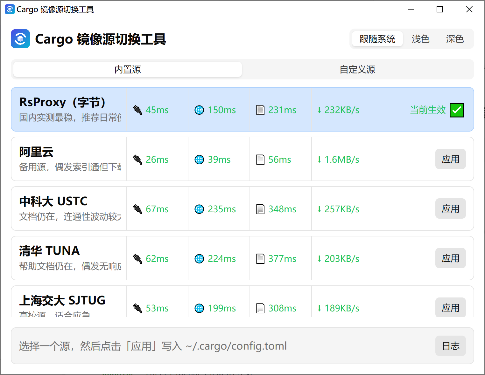
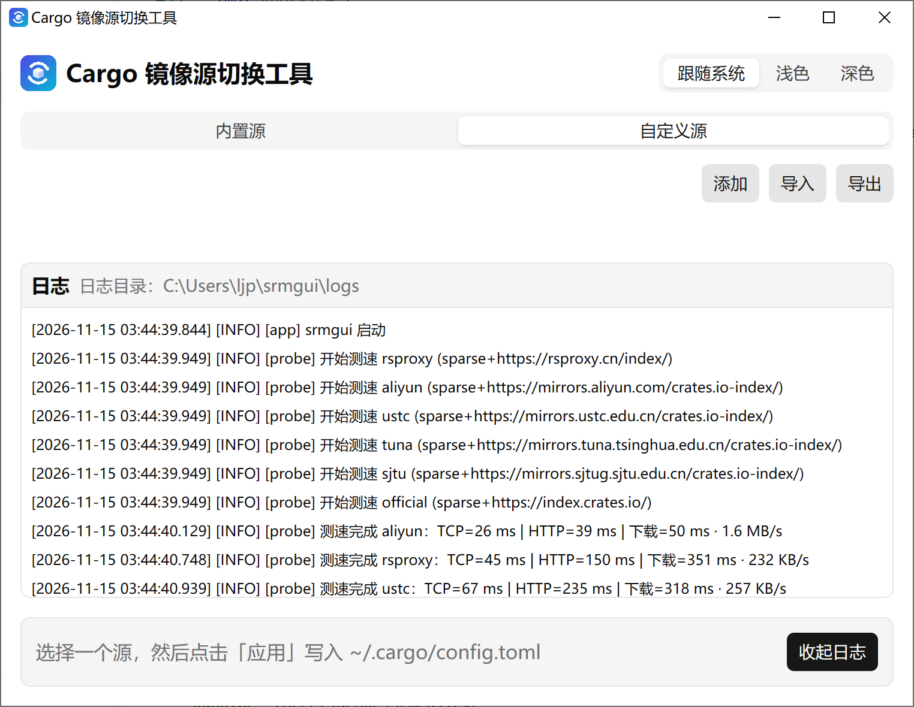
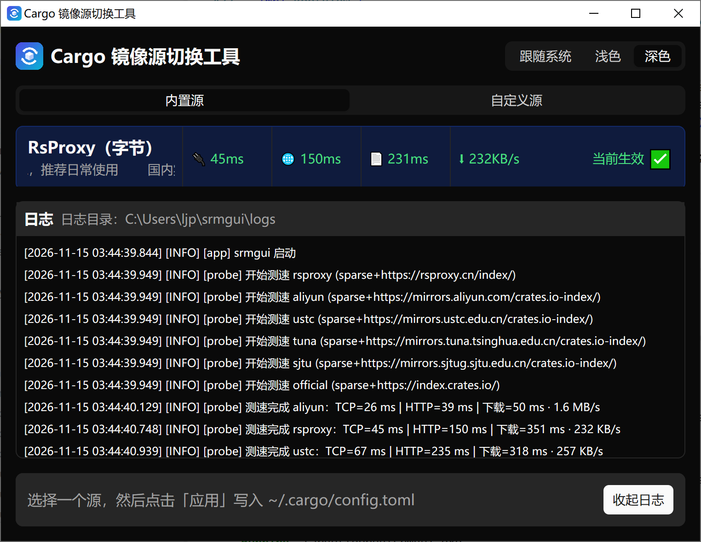

# srmgui

一个基于 [GPUI Kit](https://crates.io/crates/gpui-kit) 的桌面小工具，用于查看、测速并切换 Rust Cargo 的镜像源，配置直接写入 `~/.cargo/config.toml`。

## 界面预览

| 内置源（测速结果） | 自定义源 |
| --- | --- |
|  |  |
| 日志面板 | 深色模式 |
|  |  |

## 功能特性

- **内置常用镜像源**：RsProxy、阿里云、中科大 USTC、清华 TUNA、上海交大 SJTUG、官方 crates.io，一键切换。
- **四层自动探测**：逐层检测并展示每个源是否真正可用：
  1. TCP 连接
  2. HTTP 索引探测
  3. 索引文件解析（按 sparse registry 协议校验 `config.json`）
  4. 下载测速（报告速度）
- **定时刷新**：启动后自动测速，并每 180 秒重新探测一轮。
- **自定义源**：支持添加任意 sparse registry，按标识名判重、自动补全 `sparse+https://` 前缀。
- **导入 / 导出**：自定义源可导出为 srmgui 自定义的 `.srmgui` 文件，也可从该格式导入并自动合并（跳过内置源与重复标识）。
- **主题切换**：跟随系统 / 浅色 / 深色。
- **细节体验**：固定列宽布局，过长文字循环滚动显示，悬停显示完整详情 tips。
- **安全写入**：写入前自动备份原配置为 `config.toml.bak`。

## 内置源

| 标识名 | 名称 | Registry URL | 说明 |
| --- | --- | --- | --- |
| `rsproxy` | RsProxy（字节） | `sparse+https://rsproxy.cn/index/` | 国内实测最稳，推荐日常使用 |
| `aliyun` | 阿里云 | `sparse+https://mirrors.aliyun.com/crates.io-index/` | 备用源，偶发索引通但下载 404 |
| `ustc` | 中科大 USTC | `sparse+https://mirrors.ustc.edu.cn/crates.io-index/` | 文档仍在，连通性波动较大 |
| `tuna` | 清华 TUNA | `sparse+https://mirrors.tuna.tsinghua.edu.cn/crates.io-index/` | 帮助文档仍在，偶发无响应 |
| `sjtu` | 上海交大 SJTUG | `sparse+https://mirrors.sjtug.sjtu.edu.cn/crates.io-index/` | 高校源，适合应急 |
| `official` | 官方 crates.io | `sparse+https://index.crates.io/` | 默认源，`cargo publish` 前建议切回 |

## 使用

1. 启动程序，等待自动测速完成（每行依次显示 TCP / HTTP / 解析 / 下载四个步骤的结果）。
2. 点击目标源右侧的「应用」，配置会写入 `~/.cargo/config.toml`（优先使用 `$CARGO_HOME`）。
3. 当前生效的源会在行尾显示「当前生效 ✅」。

### 自定义源

在「自定义源」标签页填写标识名、名称、Registry URL（说明可选）后点击「添加」。URL 若未带协议，会自动规范化为 `sparse+https://<host>/`。

### 导入 / 导出

- **导出**：将当前所有非内置的自定义源保存为 `.srmgui` 文件（未写扩展名时自动补全），包含标识名、名称、URL、说明。
- **导入**：选择 `.srmgui` 文件，按以下规则合并：
  - 跳过与内置源同名的标识；
  - 跳过已存在的标识；
  - 新增项立即参与测速。

`.srmgui` 是 srmgui 自定义的 TOML 格式（v2）：

```toml
# srmgui 自定义源文件，可通过 srmgui 导入
format = "srmgui.sources"
version = 2

[[source]]
id = "demo-src"
name = "演示源"
url = "sparse+https://demo.example.com/index/"
description = "这是一个演示源"
```

导入时会校验 `format` 与 `version`，`id` / `url` 缺一不可；`name` 缺省时回退为 `id`，`description` 缺省为空。兼容 v1 格式（`name` 作为标识名）。

## 写入的配置

应用某个源后，`~/.cargo/config.toml` 的内容形如：

```toml
[source.crates-io]
replace-with = "rsproxy"

[source.rsproxy]
registry = "sparse+https://rsproxy.cn/index/"

# ...其余内置源与自定义源...

[net]
git-fetch-with-cli = true
```

选择「官方 crates.io」时不写 `replace-with`，即回到 Cargo 默认行为。

## 构建与运行

需要 Rust 工具链（edition 2024）。

```bash
cargo run            # 调试运行
cargo build --release
cargo test --bins    # 单元测试
```

### 平台支持

支持 Windows、Linux、macOS 三端，UI 与功能保持一致。

**Windows**：构建脚本会通过 `embed-resource` + `rc.exe` 将 `assets/logo.ico` 嵌入可执行文件，用于窗口 / 任务栏图标（需要 Windows SDK）。

**Linux（Debian/Ubuntu）**：需先安装系统依赖：

```bash
sudo apt update
sudo apt install -y gcc g++ clang pkg-config cmake \
  libfontconfig-dev libfreetype6-dev \
  libwayland-dev libxkbcommon-x11-dev libx11-xcb-dev \
  libwebkit2gtk-4.1-dev libssl-dev libzstd-dev \
  libasound2-dev vulkan-validationlayers libvulkan1
```

其他发行版请安装对应的开发库包。

**macOS**：需安装 Xcode Command Line Tools：

```bash
xcode-select --install
```

应用内标题旁的 logo 通过 `include_bytes!` 内嵌 `assets/logo.png`，不依赖运行时资源目录。

## 项目结构

```
srmgui/
├── assets/           # logo 源文件（svg）、界面用 png、exe 图标 ico、资源脚本 rc
├── build.rs          # Windows 下将 ico 嵌入可执行文件（Linux/macOS 跳过）
├── src/
│   ├── main.rs       # UI、状态、主题、导入导出交互
│   ├── registry.rs   # 内置源列表与 config.toml 内容生成
│   ├── config_io.rs  # 配置读取/写入、自定义源导入导出格式
│   └── net.rs        # 四层网络探测
└── Cargo.toml
```

## 技术栈

- Rust 2024 + [GPUI](https://gpui.rs) / [gpui-kit](https://crates.io/crates/gpui-kit)（含 gpui-component）
- `rustls` + `webpki-roots` 发起 HTTPS 探测
- `toml` 解析与生成配置
