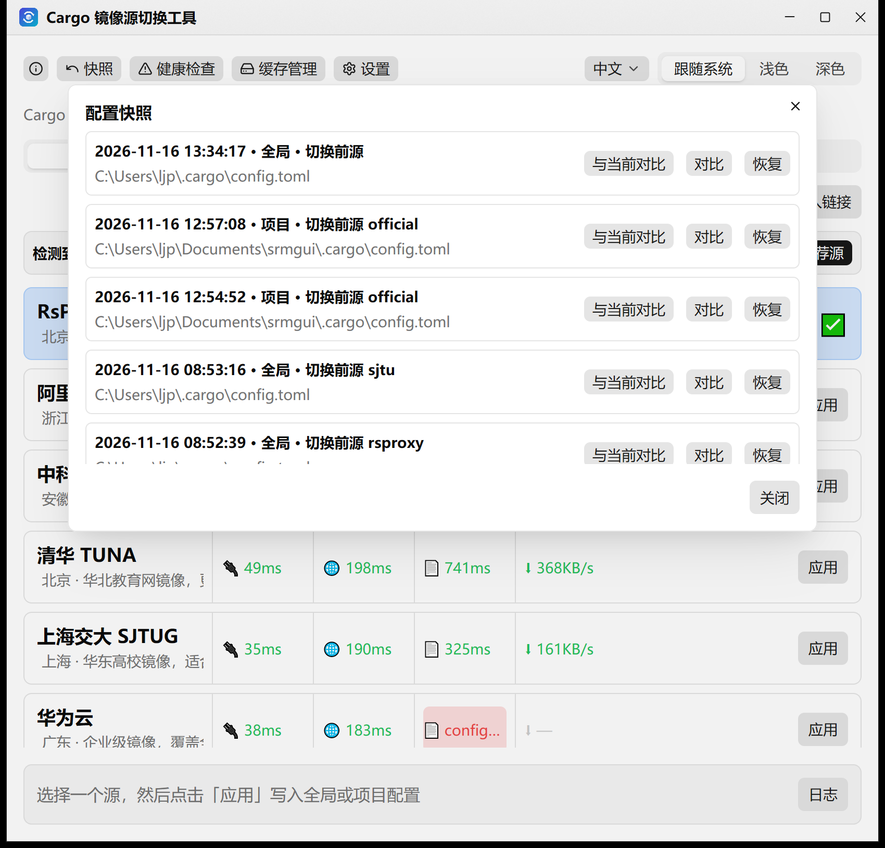
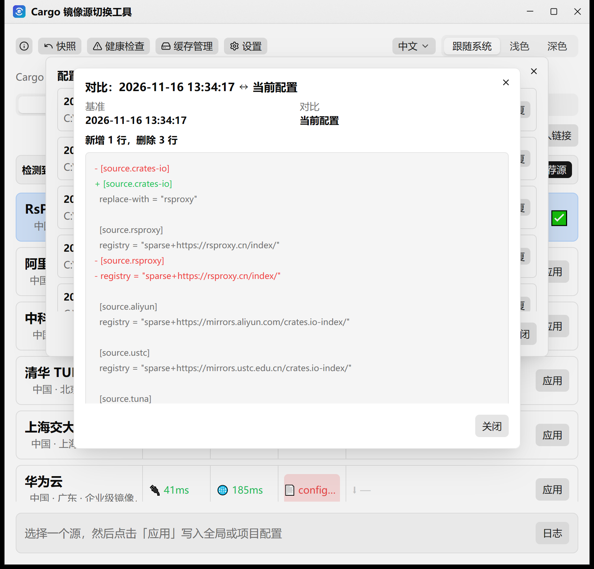
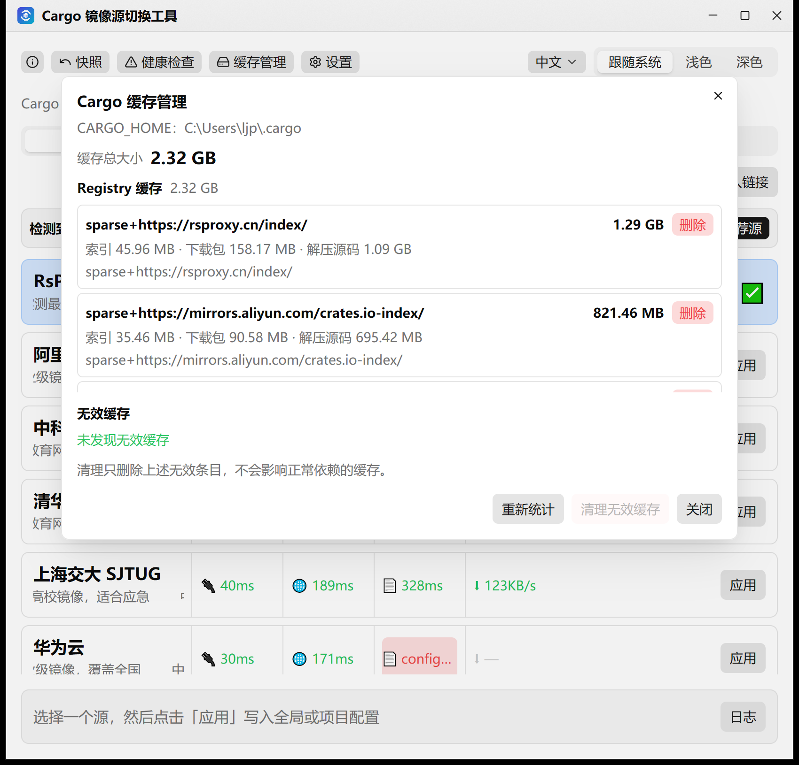
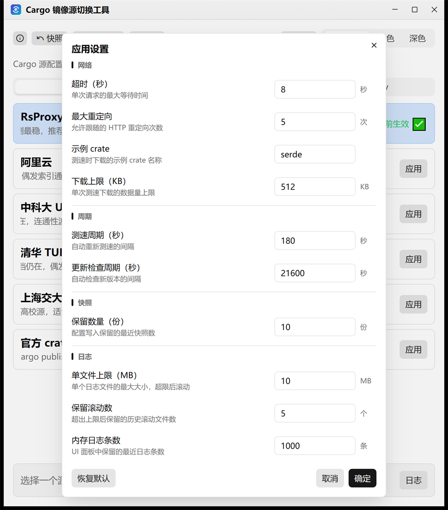

<div align="center">
  

  <h1>srmgui</h1>

  <p>查看、测速并一键切换 Rust Cargo 镜像源 · 跨平台桌面应用 + 命令行</p>

  <p>
    <a href="https://github.com/ljporljp/srmgui/releases/latest"></a>
    <a href="https://crates.io/crates/srmgui"></a>
    <a href="LICENSE"></a>
    
    
  </p>
</div>

一个基于 [GPUI Kit](https://crates.io/crates/gpui-kit) 的桌面小工具，用于查看、测速并切换 Rust Cargo 的镜像源，可按所在地区推荐并一键应用；同时支持企业私有 Registry 的索引与认证 token 管理、配置快照与回滚、健康检查、Cargo 缓存清理。配置直接写入 Cargo 配置文件，写入前可预览差异。

## 目录

- [界面预览](#界面预览)
- [功能特性](#功能特性)
- [下载安装](#下载安装)
- [内置源](#内置源)
- [使用指南](#使用指南)
- [命令行（CLI）](#命令行cli)
- [写入的配置](#写入的配置)
- [文件与目录](#文件与目录)
- [构建与运行](#构建与运行)
- [项目结构](#项目结构)
- [技术栈](#技术栈)
- [关于](#关于)

## 界面预览

| 内置源（测速结果） | 自定义源 |
| --- | --- |
|  |  |
| **私有 Registry** | **添加私有 Registry** |
|  |  |
| **配置健康检查** | **写入前预览** |
|  |  |
| **配置快照** | **快照对比** |
|  |  |
| **Cargo 缓存管理** | **日志面板** |
|  |  |
| **深色模式** | **应用设置** |
|  |  |

## 功能特性

**源管理**

- **内置源与在线清单**：内置 14 个国内镜像与官方 crates.io；启动时从 `sources.json` 拉取最新清单并缓存，离线仍可用。
- **地区推荐与四层探测**：按出口 IP 的国家 / 省份、实测下载速度与索引延迟推荐源；逐层检测 TCP、HTTP 索引、sparse `config.json` 解析与下载测速。
- **自定义源与私有 Registry**：支持任意 sparse 源；私有 Registry 的索引与 token 分开管理，token 只写入 Cargo 凭据文件。
- **导入导出与分享**：`.srmgui` 文件导入导出，也可生成 `srmgui://source?data=...` 链接分享。

**写入安全**

- **写入前预览**：展示行级 diff，确认后才落盘，写入前自动备份 `.bak`。
- **快照与回滚**：每次写入前自动快照（默认保留 10 份），支持一键恢复与两两对比。
- **健康检查**：修复重复表头、悬空 `replace-with`、孤立 `[source.x]` 段与 TOML 语法错误。
- **两级作用域与定时刷新**：支持全局或项目级写入，按设定周期自动重新测速。

**效率与体验**

- **Cargo 缓存管理**：按来源统计并清理索引、下载包与解压源码。
- **日志与诊断**：按级别过滤、关键字搜索，一键导出诊断包。
- **多语言与主题**：8 种界面语言，跟随系统 / 浅色 / 深色。
- **自动检查更新**：后台检查 GitHub Releases，支持系统下载或应用内下载安装。
- **命令行**：`status` / `use` / `probe` / `doctor` 等子命令与 GUI 共享配置，适合脚本与 CI。

## 下载安装

从 [GitHub Releases](https://github.com/ljporljp/srmgui/releases/latest) 下载对应平台的产物（下表 `<version>` 为版本号）：

| 平台 | 安装包 | 便携包 |
| --- | --- | --- |
| Windows x64 | `srmgui-<version>-windows-x64-setup.exe` | `srmgui-<version>-windows-x64-portable.zip` |
| macOS x64 / arm64 | `srmgui-<version>-macos-x64.dmg`、`srmgui-<version>-macos-arm64.dmg` | `srmgui-<version>-macos-<arch>-portable.tar.gz` |
| Linux x64 | `srmgui-<version>-linux-x64.deb`、`srmgui-<version>-linux-x64.AppImage` | `srmgui-<version>-linux-x64-portable.tar.gz` |

每个版本同时提供 `SHA256SUMS.txt` 校验文件。也可以从 crates.io 源码安装（需本地编译 GPUI，耗时较长）：

```bash
cargo install srmgui
```

## 内置源

| 标识名 | 名称 | 地区 | Registry URL | 说明 |
| --- | --- | --- | --- | --- |
| `rsproxy` | RsProxy（字节） | 北京 | `sparse+https://rsproxy.cn/index/` | 国内实测最快，推荐日常使用 |
| `aliyun` | 阿里云 | 浙江 | `sparse+https://mirrors.aliyun.com/crates.io-index/` | 企业级镜像，下载稳定 |
| `ustc` | 中科大 USTC | 安徽 | `sparse+https://mirrors.ustc.edu.cn/crates.io-index/` | 华东教育网镜像，连通性好 |
| `tuna` | 清华 TUNA | 北京 | `sparse+https://mirrors.tuna.tsinghua.edu.cn/crates.io-index/` | 华北教育网镜像，更新及时 |
| `sjtu` | 上海交大 SJTUG | 上海 | `sparse+https://mirrors.sjtug.sjtu.edu.cn/crates.io-index/` | 华东高校镜像，适合应急 |
| `huawei` | 华为云 | 广东 | `sparse+https://mirrors.huaweicloud.com/crates.io-index/` | 企业级镜像，覆盖全国 |
| `cernet` | CERNET 联合镜像 | — | `sparse+https://mirrors.cernet.edu.cn/crates.io-index/` | 教育网联合镜像，自动调度 |
| `nju` | 南京大学 | 江苏 | `sparse+https://mirrors.nju.edu.cn/crates.io-index/` | 江苏高校镜像，华东备用 |
| `bfsu` | 北外 BFSU | 北京 | `sparse+https://mirrors.bfsu.edu.cn/crates.io-index/` | 北京教育网镜像，华北备用 |
| `sdu` | 山东大学 | 山东 | `sparse+https://mirrors.sdu.edu.cn/crates.io-index/` | 山东高校镜像，华北备用 |
| `hust` | 华中科技大学 | 湖北 | `sparse+https://mirrors.hust.edu.cn/crates.io-index/` | 华中高校镜像，中部备用 |
| `zju` | 浙江大学 | 浙江 | `sparse+https://mirrors.zju.edu.cn/crates.io-index/` | 浙江高校镜像，华东备用 |
| `neusoft` | 东软 | 辽宁 | `sparse+https://mirrors.neusoft.edu.cn/crates.io-index/` | 东北镜像，北方备用 |
| `nyist` | 南阳理工学院 | 河南 | `sparse+https://mirror.nyist.edu.cn/crates.io-index/` | 河南高校镜像，中原备用 |
| `official` | 官方 crates.io | 全球 | `sparse+https://index.crates.io/` | 默认源，`cargo publish` 前建议切回 |

内置源清单来自仓库根目录的 [`sources.json`](sources.json)（`srmgui.manifest` v3），启动时拉取并缓存到 `<HOME>/srmgui/srmgui-sources.json`；离线时回退到本地缓存，缓存不存在则使用编译期内置清单。

## 使用指南

### 快速开始

1. 启动后自动测速，顶部推荐条显示识别到的地区与推荐源，可点击「应用推荐源」或目标源右侧的「应用」。
2. 在「写入前预览」中确认 diff 后点击「确认写入」；点击「取消」不会改动配置。
3. 标题栏的「快照」「健康检查」「缓存」「设置」分别用于回滚配置、修复损坏配置、清理磁盘与调整参数。
4. 选中源后可「分享」生成链接，收到链接时点击「导入链接」粘贴导入；右上角可切换界面语言。

### 地区推荐

启动后（以及每轮测速结束）按出口 IP 识别国家与省份，并在顶部给出推荐条：中国大陆优先同省可用源，其次按实测下载速度与索引延迟排序；其他地区优先官方 crates.io；识别失败时沿用上次结果。点击「应用推荐源」直接进入写入前预览。

### 源清单与分享

- **在线清单**：启动与每次更新检查时拉取 `sources.json`，成功后替换列表并写入本地缓存；也可点击「刷新清单」手动触发。
- **分享 / 导入链接**：选中源点击「分享」复制 `srmgui://source?data=...`（Base64 编码标识名、名称、URL、说明与地区）；粘贴他人链接即可导入，已存在的标识自动跳过。

### Cargo 缓存管理

点击标题栏的「缓存」扫描 `$CARGO_HOME`（默认 `~/.cargo`），按来源汇总 registry 索引、下载包与解压源码的占用，可删除单个来源的缓存并清理无效条目。扫描结果会缓存，体积变化后自动重新统计。

### 配置快照与回滚

每次真正写入前，当前配置会保存为一份快照：

- 快照保存在 `<HOME>/srmgui/snapshots/`，默认保留最近 10 份，超出自动删除最旧的；
- 快照记录的是**切换前**的配置，标签以「切换前源」标注当时实际生效的源；
- 在「快照」中点击「恢复」即可回滚（恢复前仍备份 `.bak`）；
- 每条快照支持「与当前对比」或选择另一条快照对比。

### 配置健康检查

其他工具改动 `config.toml` 后常留下 cargo 无法解析或会静默失效的残留。点击标题栏的「健康检查」逐条列出问题并一键修复：

- **重复表头**：同一个 `[source.x]` 被重复追加；修复时保留最后一段。
- **残留替换块**：`replace-with` 指向的源已不存在；修复时移除该 `replace-with`。
- **孤立源段**：`[source.x]` 既未被引用也不属于 srmgui 管理的源；修复时删除该段。
- **语法错误**：无法就地修补时回退到最近一份可解析的快照，没有快照则使用 `config.toml.bak`。

修复前会自动保存快照与 `.bak` 备份，无法解析且无可用备份时会明确提示，不会强行覆盖。

### 自定义源

在「自定义源」标签页填写标识名、名称、Registry URL（说明可选）后点击「添加」。URL 若未带协议，会自动规范化为 `sparse+https://<host>/`。

### 私有 Registry

在「私有 Registry」标签页管理企业私有镜像，与内置源替换是两套独立配置：

- **名称**：对应 `Cargo.toml` 中 `registry = "名称"` 的标识，仅允许字母、数字、连字符与下划线，`crates-io` 为保留名称；
- **Index URL**：支持 `sparse+https://...` 与 `https://...`、`ssh://...`、`git@...` 等 git 索引；未带协议时补全为 `sparse+https://<host>/`；
- **Token（可选）**：写入 `$CARGO_HOME/credentials.toml` 的 `[registries.<name>]`，匿名只读镜像或使用 credential provider 时可留空；
- 索引写入当前作用域的 `config.toml`，删除时同步移除对应 registry，并在无其他引用时清理 token。

### 导入 / 导出

- **导出**：将非内置的自定义源保存为 `.srmgui` 文件（自动补全扩展名）。
- **导入**：选择 `.srmgui` 文件合并，跳过与内置源同名或已存在的标识，新增项立即参与测速。

`.srmgui` 是 srmgui 自定义的 TOML 格式（v2）：

```toml
# srmgui 自定义源文件，可通过 srmgui 导入
format = "srmgui.sources"
version = 2

[[source]]
id = "demo-src"
name = "演示源"
url = "sparse+https://demo.example.com/index/"
description = "这是一个演示源"
```

导入时会校验 `format` 与 `version`，`id` / `url` 必填，`name` 缺省回退为 `id`，`description` 缺省为空；兼容 v1 格式（`name` 作为标识名）。

### 检查更新

启动后后台检查 GitHub Releases，之后按设置的周期（默认 6 小时）复查。发现新版本时右上角提示，可选择用系统下载工具打开链接，或在应用内下载安装包并自动启动安装；结果与过程都会写入日志面板。

### 应用设置

点击工具栏的「设置」可调整运行参数，保存后立即生效（定时任务按新周期重建，并马上重新测速一轮）：

| 分组 | 配置项 | 默认值 | 允许范围 |
| --- | --- | --- | --- |
| 网络 | 超时（秒） | 8 | 1 – 3600 |
| 网络 | 最大重定向 | 5 | 1 – 20 |
| 网络 | 示例 crate | `serde` | 字母、数字、`-`、`_` |
| 网络 | 下载上限（KB） | 512 | 1 – 102400 |
| 周期 | 测速周期（秒） | 180 | 10 – 86400 |
| 周期 | 更新检查周期（秒） | 21600 | 60 – 604800 |
| 快照 | 保留数量（份） | 10 | 1 – 100 |
| 日志 | 单文件上限（MB） | 10 | 1 – 1024 |
| 日志 | 保留滚动数（个） | 5 | 1 – 50 |
| 日志 | 内存日志条数 | 1000 | 100 – 100000 |

- 输入只接受合法字符，越界或无法解析时在顶部提示且不写入；「恢复默认」重置，「取消」不做改动；
- 设置保存在 `<HOME>/srmgui/srmgui-settings.toml`，仅记录与默认值不同的字段。

## 命令行（CLI）

同一个可执行文件既是 GUI，也提供命令行子命令，与界面共用同一份配置、快照与设置，适合脚本与 CI：

```bash
srmgui status                                   # 作用域、配置文件、当前源
srmgui list                                     # 内置源 + 自定义源，* 为当前生效
srmgui use rsproxy                              # 按默认作用域切换源
srmgui use aliyun --scope project --project .   # 切换项目级 .cargo/config.toml
srmgui probe                                    # 测速当前源；也可 probe rsproxy aliyun 或 --all
srmgui custom list                              # 自定义源列表
srmgui custom add corp --url mirror.example.com --name "公司镜像"
srmgui custom remove corp
srmgui custom export ./sources                  # 自动补全 .srmgui 扩展名
srmgui custom import ./sources.srmgui
srmgui registry add corp --index crates.example.com --token <token>
srmgui registry list
srmgui registry remove corp
srmgui snapshot list                            # 配置快照
srmgui snapshot restore 1                       # 恢复第 1 条，或 latest
srmgui scope                                    # 查看默认作用域
srmgui scope project --project .                # 设置默认作用域（与 GUI 共享）
srmgui doctor --fix                             # 健康检查并修复
srmgui --help
```

- 不带任何参数（或 `srmgui gui`）时打开图形界面；
- `--json` 输出机器可读结果，便于脚本解析（`status` / `list` / `probe` / `custom list` / `snapshot list` / `doctor` 等）；
- `--scope global|project` 临时覆盖作用域，`--project <dir>` 指定项目目录（可为项目内任意路径，自动向上查找 `Cargo.toml`），两者都不会改动 GUI 的默认设置，只有 `srmgui scope` 会持久化；
- 退出码：`0` 成功，`1` 执行失败（含 `probe` 存在失败层、`doctor` 检出问题），`2` 参数错误，`probe` 与 `doctor` 可直接用于 CI 门禁。

## 写入的配置

应用某个源后，全局 `config.toml` 的内容形如：

```toml
[source.crates-io]
replace-with = "rsproxy"

[source.rsproxy]
registry = "sparse+https://rsproxy.cn/index/"

# ...其余内置源与自定义源...

[net]
git-fetch-with-cli = true
```

选择「官方 crates.io」时不写 `replace-with`，即回到 Cargo 默认行为。

私有 Registry 的索引与 token 分开存放：

```toml
# $CARGO_HOME/config.toml
[registries.company]
index = "sparse+https://cargo.example.com/index/"
```

```toml
# $CARGO_HOME/credentials.toml
[registries.company]
token = "******"
```

## 文件与目录

| 用途 | 路径 |
| --- | --- |
| 全局 Cargo 配置 | `$CARGO_HOME/config.toml`（默认 `~/.cargo`；若已存在旧版 `config` 则写入 `config`） |
| 项目级 Cargo 配置 | `<项目根>/.cargo/config.toml`（同样优先旧版 `config`） |
| Registry 凭据 | `$CARGO_HOME/credentials.toml`（若已存在旧版 `credentials` 则写入 `credentials`） |
| 应用设置 | `<HOME>/srmgui/srmgui-settings.toml` |
| 自定义源元数据 | `<HOME>/srmgui/srmgui-customs.toml` |
| 源清单缓存 | `<HOME>/srmgui/srmgui-sources.json` |
| 配置快照 | `<HOME>/srmgui/snapshots/` |
| 运行日志 | `<HOME>/srmgui/logs/` |
| 缓存扫描结果 | `<HOME>/srmgui/cache-report.json` |

## 构建与运行

需要 Rust 1.85+（edition 2024）。

```bash
cargo run            # 调试运行
cargo build --release
cargo test --bins    # 单元测试
```

### 平台支持

支持 Windows、Linux、macOS 三端，UI 与功能保持一致；CI 产出 Windows x64、Linux x64、macOS x64 / arm64 四类构建。

**Windows**：构建脚本会将 `assets/logo.ico` 嵌入可执行文件，用于窗口 / 任务栏图标（需要 Windows SDK）。

**Linux（Debian/Ubuntu）**：需先安装系统依赖：

```bash
sudo apt update
sudo apt install -y gcc g++ clang pkg-config cmake \
  libfontconfig-dev libfreetype6-dev \
  libwayland-dev libxkbcommon-x11-dev libx11-xcb-dev \
  libwebkit2gtk-4.1-dev libssl-dev libzstd-dev \
  libasound2-dev vulkan-validationlayers libvulkan1
```

其他发行版请安装对应的开发库包。

**macOS**：需安装 Xcode Command Line Tools：

```bash
xcode-select --install
```

## 项目结构

```
srmgui/
├── assets/           # logo 源文件（svg）、界面用 png、exe 图标 ico、资源脚本 rc
├── build.rs          # Windows 下将 ico 嵌入可执行文件（Linux/macOS 跳过）
├── sources.json      # 内置源清单（启动时在线拉取，离线回退到缓存/内置清单）
├── locales/          # 8 种语言的国际化文案
├── packaging/        # Windows 安装脚本、macOS 签名公证脚本、Linux desktop 文件
├── .github/workflows/ # 跨平台构建与 Release 发布流水线
├── src/
│   ├── main.rs       # 程序入口与窗口初始化
│   ├── app.rs        # 应用状态（源、地区、缓存、更新等）与配置持久化
│   ├── model.rs      # 状态类型、语言与主题枚举
│   ├── root_view.rs  # 主界面布局、应用/回滚/测速/推荐等交互
│   ├── source_list.rs # 源列表与测速结果展示
│   ├── private_list.rs # 私有 Registry 列表与删除
│   ├── add_form.rs   # 自定义源与私有 Registry 添加表单
│   ├── config_dialog.rs # 写入前预览、快照列表、diff 查看对话框
│   ├── cache_dialog.rs # Cargo 缓存管理对话框
│   ├── settings_dialog.rs # 应用设置对话框：网络、周期、快照与日志参数
│   ├── log_panel.rs  # 日志面板：级别过滤、关键字搜索与诊断包导出
│   ├── ui.rs         # 共用 UI 片段（滚动文字、分隔线、底部滑入面板等）
│   ├── diff.rs       # 行级 LCS diff 算法
│   ├── registry.rs   # 编译期内置源清单与 config.toml 内容生成
│   ├── manifest.rs   # 在线源清单订阅与 srmgui:// 分享链接
│   ├── region.rs     # 出口 IP 地区识别与按地区/测速推荐
│   ├── config_io.rs  # 配置读写、快照、自定义源、私有 Registry 与设置持久化
│   ├── health.rs     # 配置健康检查：重复表头、残留替换块、孤立源段与语法错误
│   ├── cache.rs      # Cargo 缓存扫描、按来源统计与清理
│   ├── diagnostics.rs # 诊断包导出（不含认证凭据）
│   ├── logger.rs     # 内存/文件日志与本地时间戳
│   ├── update.rs     # 检查 GitHub Releases、下载并启动安装包
│   ├── net.rs        # 四层网络探测
│   ├── util.rs       # URL 规范化等小工具
│   └── cli.rs        # 命令行子命令实现
└── Cargo.toml
```

## 技术栈

- Rust 2024 + [GPUI](https://gpui.rs) / [gpui-kit](https://crates.io/crates/gpui-kit)（含 gpui-component）
- `rustls` + `rustls-native-certs` / `webpki-roots` 负责 HTTPS 探测
- `toml` / `toml_edit` 读写配置，`rust-i18n` 提供 8 种语言文案
- `serde` / `serde_json` / `base64` 处理源清单与分享链接，`chrono` 生成带时区的本地时间戳

## 关于

- **作者**：liujinpeng
- **邮箱**：[imljp@foxmail.com](mailto:imljp@foxmail.com)
- **GitHub**：[https://github.com/ljporljp/srmgui](https://github.com/ljporljp/srmgui)
- **Crates.io**：[https://crates.io/crates/srmgui](https://crates.io/crates/srmgui)
- **协议**：MIT

本项目（srmgui）及其源代码的所有权归作者 liujinpeng 所有。在 MIT 协议条款下，任何人可自由使用、复制、修改、合并、出版、分发、再许可本软件，但须在所有副本或重要部分中保留上述版权声明与本许可声明。
